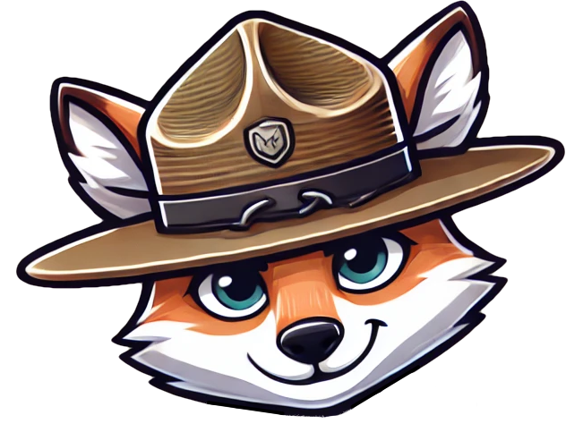
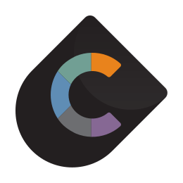

#  Meet Ranger

???+ info "Ranger is being reorganized"
    The earlier Ranger stack (a chat API with workflows, MCP and RAG, shipped as a Docker stack or an appliance) is being retired. Ranger is now built from the parts below. These docs describe the new layout and grow as each part lands.

Ranger is AI tooling for cyber range training, exercises and simulation. It helps you design an event, build and run it, and learn from it, using local or frontier models. It works on closed and air-gapped ranges.

## The Problem

An exercise today lives in pieces: a scenario document, a network build, injects in a spreadsheet, activity in logs, and lessons in someone's notes. A good scenario takes an engineer and days of back-and-forth. Once it's written, every tool that builds or runs the event has to be told the same things again.

AI makes this worse when it works from scraps. A model asked cold invents things: a news story that contradicts the ground truth, a simulated bank clerk who doesn't know which bank they work for, an after-action summary that can't tell the plan from what actually happened.

## The Parts

| Part | Status | What it does |
|---|---|---|
| [Chronicle](chronicle.md) | Concept | One record for the whole event. Apps publish what they add and subscribe to what they need. |
| [Scenario Builder](scenario-builder/index.md) | Experimental | A guided workspace, with an AI agent, for writing the scenario: the world and what the event must achieve. |
| [Range Automation](range-automation.md) | Next | Builds, runs and adapts the range from the Chronicle. |

They fit together like this:

1. **Scenario Builder** asks the designer the questions that lead to a good scenario and records every answer, along with who gave it and why. Its output is one scenario JSON document.
2. That document is the first page of a **Chronicle**, the record of the event.
3. **Range Automation** and other apps (GraySpace, GHOSTS, the Crucible apps) subscribe to the parts they need, build and run the event, and write back what they built, did and saw.
4. When the event ends, the Chronicle *is* the event, ready to seed the next one.

## Works With

???+ tip "Crucible and GHOSTS"
    
    Ranger works alongside the SEI's **Crucible Framework**, a modular system for creating and managing virtual environments for training and exercises ([source](https://github.com/cmu-sei/crucible), [docs](https://cmu-sei.github.io/crucible/)), and **GHOSTS**, which simulates the people on the range ([source](https://github.com/cmu-sei/GHOSTS/)).

## Principles

- **Local models first.** Every part is built and tested to work on an open-weight model such as gemma-4-26b served by Ollama. A frontier model is used where one is available.
- **People decide.** The AI drafts and proposes. Nothing a person stated changes without their approval, and every change records who made it.
- **The right eyes only.** Ground truth stays with exercise control, and visibility travels with the data, for AI models as well as people.
